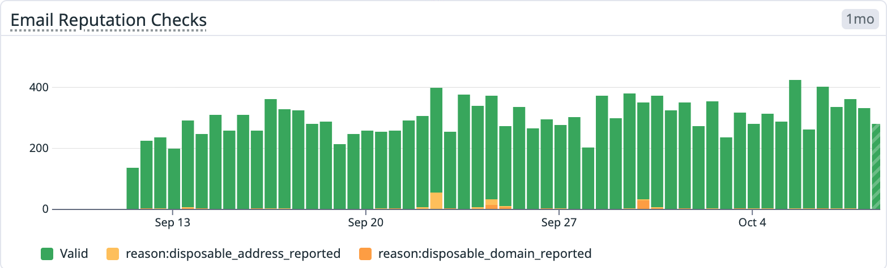
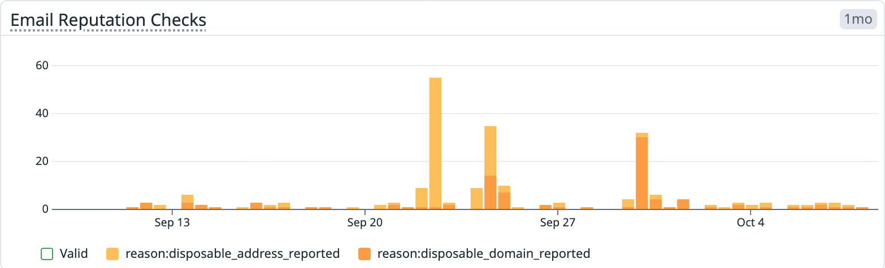

PyPI improves on checks for the reputation of an email address
when used to register an account or add to an existing account,
and rejects addresses identified as disposable.

With the new check in place,
`outlook.com` and `hotmail.com` addresses can once again be used on PyPI.

<!-- more -->

## Background

In June 2024 we [prohibited Outlook email domains](2024-06-16-prohibiting-msn-emails.md)
after a malware campaign registered accounts in bulk
with `outlook.com` and `hotmail.com` addresses.

Until now, PyPI has blocked disposable email addresses with two lists:
the public [disposable-email-domains](https://github.com/disposable-email-domains/disposable-email-domains) list,
and our own internal list of prohibited domains.
Both are static domain lists, and neither can tell a throwaway address
apart from a real one on a large provider like Outlook.

The downside of this approach was that we had to apply a broad prohibition to entire domains,
blocking new account creation from legitimate users on those domains.
This also relied heavily on investigation and decisioning from staff
or volunteer administrators, which led to slower remediation times.

## Checking email reputation

When an email address passes the existing domain checks,
PyPI now asks an email reputation service whether the address is disposable.
This covers disposable providers that register new domains
faster than any list can track,
as well as throwaway aliases on public email providers.

When the service reports that a whole domain is a disposable provider,
PyPI adds that domain to its prohibited list,
so the next attempt is rejected without another lookup.

This process happens automatically, and no longer requires any volunteer
or staff time to add to the internal prohibited list.
This is more important in the new age of autonomous exploits,
as the time to react is critical.

As of today, `outlook.com` and `hotmail.com` addresses
can once again be used to register a PyPI account
or added to an existing account.

## Results so far

Over the past month since I added email reputation checking,
the overwhelming volume of results are positive, which is a good signal.

Removing the Valid responses shows a more detailed picture:

We have since blocked disposable 62 domains from being used to register for user accounts on PyPI,
and disallowed over 120 attempts at using a disposable address from an otherwise valid domain.

If you run into problems registering or adding an email address,
please open an issue on the [support tracker](https://github.com/pypi/support).
If none of the Issue categories match, email support at pypi dot org with complete details.

## Thanks

Thanks to [UserCheck](https://www.usercheck.com/) for their donation of the service to aid with defending the Python ecosystem.
Find them, and our other sponsors, on the [PyPI Sponsors page](https://pypi.org/sponsors/).

_Mike's work on PyPI is thanks to continued support from [Alpha-Omega](https://alpha-omega.dev/)._
