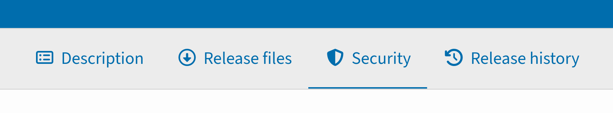
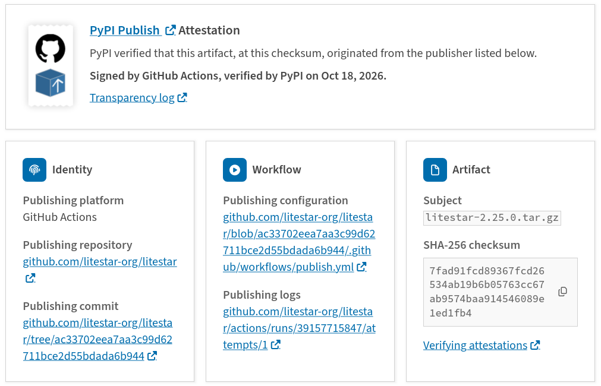
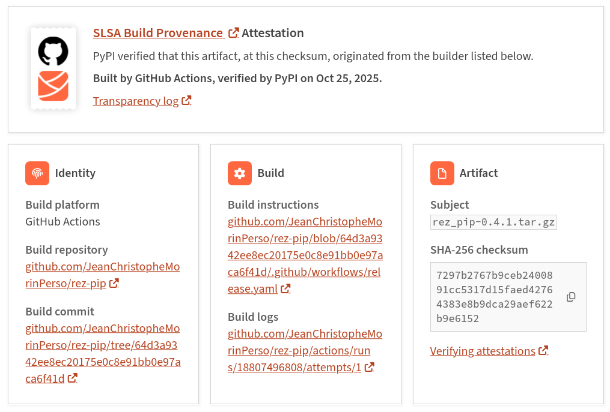
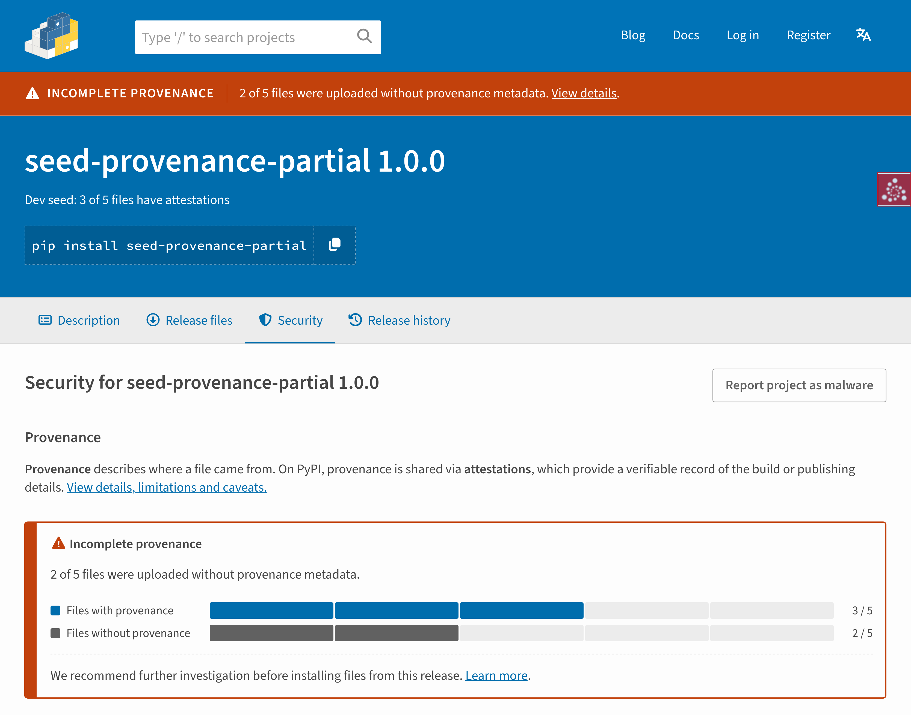
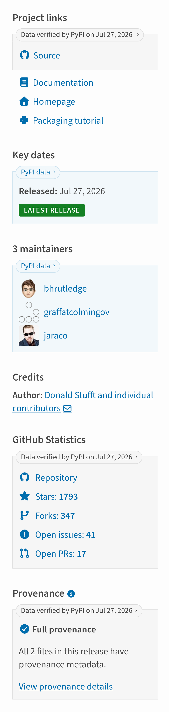
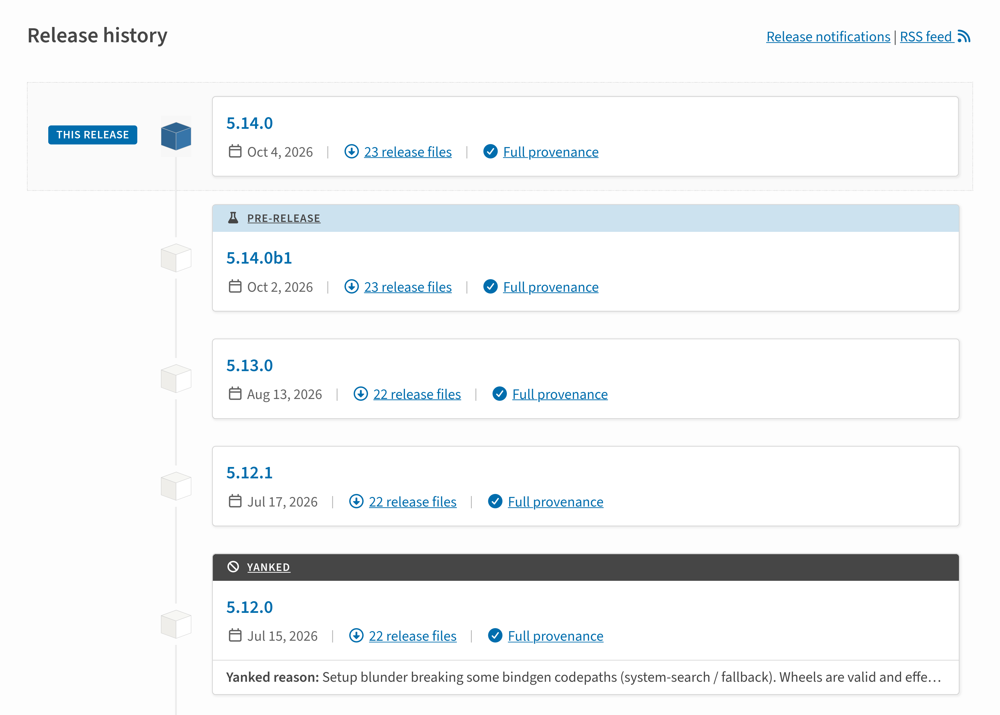

In July, we [announced a series of planned updates](2026-07-22-ui-updates.md) to the PyPI user interface, aimed at improving how we surface security signals and display package details.

We're pleased to share that this work is now complete and live on [PyPI](https://pypi.org/).

<!-- more -->

## Context

With the rapid growth of the Python ecosystem, PyPI has become an increasingly attractive target for malicious actors. In response, the PyPI team has [delivered many security features](https://docs.pypi.org/about/security-and-internals/#pypi-security-features) while taking a more active role in helping PyPI users assess and understand package security.

[Digital attestations](2024-11-14-pypi-now-supports-digital-attestations.md), introduced in 2024, are an example of this effort, providing a verifiable record of a release file's _provenance_ (where it came from). However, provenance and attestations are still unfamiliar concepts for many PyPI users, and PyPI's interface did little to communicate their meaning, importance, or limitations.

To address this, PyPI partnered with [Kabu Creative](https://kabucreative.com/) to bring clearer security signals to the PyPI UI, implementing the recommendations developed in the [OpenSSF Attestations Style Guide](https://repos.openssf.org/attestations-style-guide).

Here's a look at what's changed, what it means for you, and what actions you can take.

## The New Security Tab

The new **security tab** communicates release provenance and attestation status, giving you a dedicated place to verify where the release files came from.

<figure markdown="1">
  
  <figcaption markdown="span">The new security tab on a PyPI project detail page</figcaption>
</figure>

### Baseline Provenance States

Every release on PyPI starts in one of two baseline states:

#### 1. [Full Provenance](https://docs.pypi.org/using-pypi/package-security/provenance/)

This means that 100% of the files in the release have attestations, carrying either or both of the supported types:

**[PyPI Publish](https://docs.pypi.org/attestations/publish/v1/) attestations** confirm the file was published by a [PyPI Trusted Publisher](https://docs.pypi.org/trusted-publishers/):

<figure markdown="1">
  
  <figcaption markdown="span">A [PyPI Publish attestation](https://docs.pypi.org/attestations/publish/v1/) on PyPI</figcaption>
</figure>

**[SLSA Build Provenance](https://slsa.dev/spec/v1.2/build-provenance) attestations** link the file back to its exact source commit, build platform, and instructions:

<figure markdown="1">
  
  <figcaption markdown="span">A [SLSA Build Provenance attestation](https://slsa.dev/spec/v1.2/build-provenance) on PyPI</figcaption>
</figure>

You can review attestation metadata directly in the UI, or click on the transparency log link for more information.

#### 2. [Without Provenance](https://docs.pypi.org/using-pypi/package-security/source-code-security/)

"Without provenance" simply means that no files in the release have an attestation. This is typical for older releases or projects that have not yet configured Trusted Publishing. **No provenance does not necessarily indicate that a file is malicious; it instead means that the file origin cannot be cryptographically verified**.

When no provenance exists, you should rely on surrounding trust signals to assess security, such as maintainer history, release patterns, and repository activity. If you maintain the package, use [Trusted Publishing](https://docs.pypi.org/trusted-publishers/) with a [publisher that generates attestations](https://docs.pypi.org/attestations/producing-attestations/) for your next release.

### Warning States and Anomalies

Provenance warnings are designed to help you identify when a file may not have come from the project's maintainers, for example, if an attacker has taken over an account or a publishing workflow.

When provenance metadata looks unusual or conflicts with a project's history, PyPI surfaces a prominent warning. Many warnings have legitimate explanations, but each one is worth checking before you install.

#### [Incomplete Provenance](https://docs.pypi.org/using-pypi/package-security/provenance/#incomplete-provenance)

This means that some files carry attestations while others do not (e.g., wheels were published via Trusted Publishing, but the source tarball was uploaded using an API token).

Exercise caution if you see this warning. Check release notes for build issues or ask in the project's issue tracker before installing.

#### [Inconsistent Provenance](https://docs.pypi.org/using-pypi/package-security/provenance/#inconsistent-provenance)

This warning indicates that files within the same release originate from different build systems or source repositories.

Treat this as a high-priority warning. Check the attestation metadata to confirm whether all files came from sources controlled by the maintainers.

#### [Change of Provenance](https://docs.pypi.org/using-pypi/package-security/provenance/#change-of-provenance)

This warning tells you that the release files originated from a different repository or workflow than a previous release. While often legitimate (such as an organization name change or repository migration), it can also indicate a compromised pipeline or account takeover.

If you see this warning, check the project release notes or official channels to confirm that an infrastructure migration was planned.

#### [Loss of Provenance](https://docs.pypi.org/using-pypi/package-security/provenance/#loss-of-provenance)

This means that a project that previously published with attestations has reverted to uploading release files without them.

Check whether the maintainers intentionally changed their publishing process, for example by switching back to API tokens, or by changing their publishing configuration so that it no longer generates attestations. If this is unexpected, treat the release with skepticism until verified.

#### Late Files

This warning is shown when one or more files were uploaded more than 14 days after the initial release timestamp. It only appears on releases prior to a policy change, as PyPI [rejects new files after 14 days](2026-07-22-releases-now-reject-new-files-after-14-days.md) since July 2026.

We recommend inspecting individual file timestamps before installing.

To learn more about provenance and attestations, including warning states, see our [user documentation](https://docs.pypi.org/using-pypi/package-security/provenance/).

<figure markdown="1">
  
  <figcaption markdown="span">An example provenance warning on PyPI, showing a release with [incomplete provenance](https://docs.pypi.org/using-pypi/package-security/provenance/#incomplete-provenance)</figcaption>
</figure>

## Redesigned Project Detail Page

To support these changes, the project detail page has also been updated:

* Provenance warnings now appear at the top of the page, alongside status banners for yanked releases, archived projects, and pre-releases. If a project or release is quarantined, only the quarantine banner is shown, as it takes precedence over all other warnings and banners.
* When a release has full provenance or provenance warnings, its status is displayed in the sidebar, linking through to the security tab for more information.
* Metadata is now ordered by utility and labeled as "PyPI data" or "Data verified by PyPI", replacing the old design where data was grouped and ordered by verification status.

<figure markdown="1">
  { width="300" }
  <figcaption markdown="span">The redesigned metadata sidebar, with information ordered by utility</figcaption>
</figure>

## Release Files and Release History

The redesigned **release files tab** helps you find the right file by searching and filtering long lists. You can also view the provenance status of each file within the table, and quickly identify late files, which are marked with an orange badge.

Likewise, the **release history tab** now provides more details about each release, exposing file count, provenance status, and release status (i.e., quarantined, yanked, archived, or pre-release).

<figure markdown="1">
  
  <figcaption markdown="span">The redesigned release history tab, with release status, file count, and provenance status</figcaption>
</figure>

## Getting Help

Alongside the interface updates, [PyPI's user documentation](https://docs.pypi.org/) has been extended to help you better navigate package security. Read our [package security guide](https://docs.pypi.org/using-pypi/package-security/introduction/) to learn about:

* [Assessing source code security](https://docs.pypi.org/using-pypi/package-security/source-code-security/)
* [Checking provenance (where a package came from)](https://docs.pypi.org/using-pypi/package-security/provenance/)
* [Verifying package integrity](https://docs.pypi.org/using-pypi/package-security/package-integrity/)
* [Protecting yourself from common security attacks](https://docs.pypi.org/using-pypi/package-security/common-attacks/)
* [Reporting security issues](https://docs.pypi.org/using-pypi/package-security/reporting-issues/)

## Looking Ahead & Acknowledgments

The new security tab gives PyPI a dedicated home for future attestation types and security notices. To help the wider open source ecosystem benefit from this work, we've also [published a case study in the OpenSSF Attestations Style Guide](https://repos.openssf.org/attestations-style-guide/pypi-case-study) detailing the design patterns and error models developed during this project.

This initiative was funded by the [Open Source Security Foundation](https://openssf.org/) and implemented by [Kabu Creative](https://kabucreative.com/). We would like to thank [Dustin Ingram](https://github.com/di), [Zach Steindler](https://github.com/steiza), and the members of the [OpenSSF Securing Software Repositories Working Group](https://repos.openssf.org/) for championing this effort. Special thanks to [Mike Fiedler](https://github.com/miketheman), [Jacob Coffee](https://github.com/JacobCoffee), and members of the PyPI team for their thoughtful design feedback and code reviews, [@cofiem](https://github.com/cofiem) for their contributions to the new release files tab, and our [user interview participants](https://github.com/pypi/warehouse/issues/20111) and community testers for helping shape the final design.

Finally, we would like to thank the OpenSSF for their funding and continued partnership in securing the Python packaging ecosystem.
