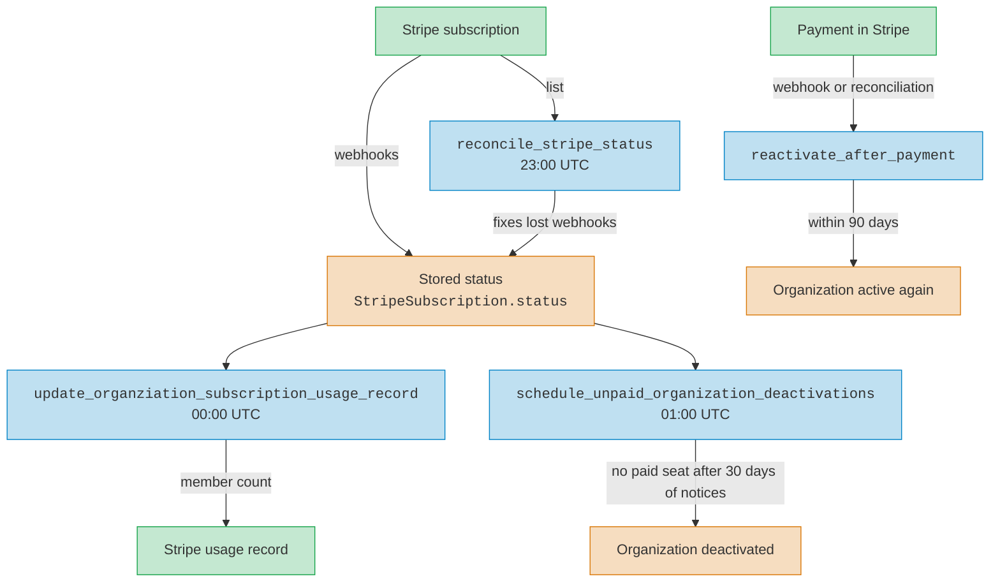
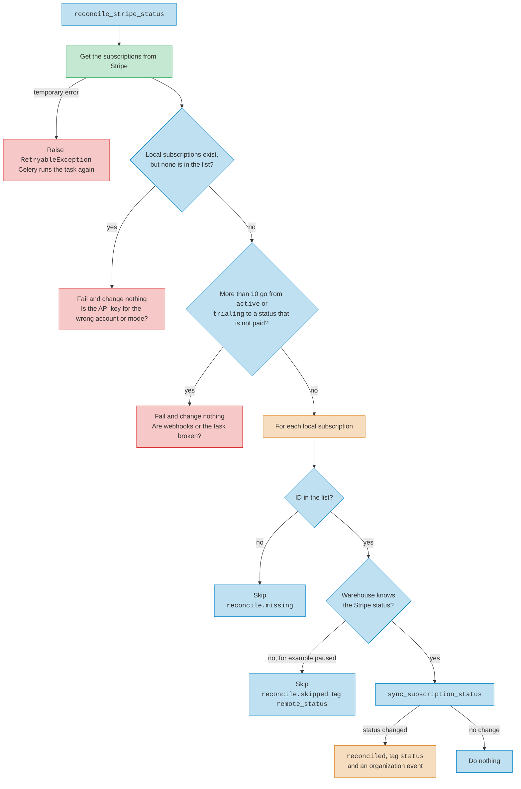
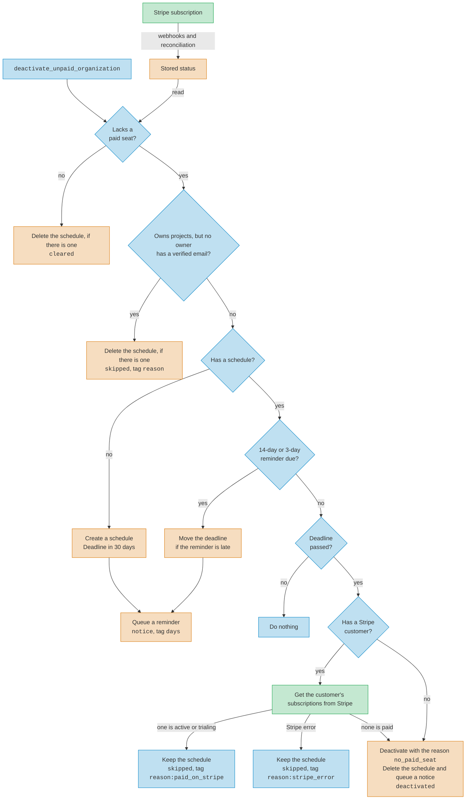

# Billing

To be in good standing, a company organization must be active. It must also
have a subscription with the status `active`, or a manual
activation that is not expired. The code also accepts `trialing`, but
Warehouse does not create subscriptions with a trial.

Stripe owns the subscription status. Warehouse keeps a copy in
`StripeSubscription.status`, so it does not call Stripe on every request.

The overview shows how the subscription status moves between Stripe and
Warehouse. The sections below give the details.

The diagrams on this page use these colors:

- Warehouse code and checks
- Database reads, writes, and organization events
- Stripe subscriptions, webhooks, and API calls
- Failure the task raises

## How the status changes

These paths call `sync_subscription_status` in
`warehouse/subscriptions/services.py`:

- The `customer.subscription.updated` and `customer.subscription.deleted`
  webhooks, in `warehouse/api/billing.py`.
- The `reconcile_stripe_status` task. It runs each night at 23:00 UTC and
  fixes a status that a lost webhook did not update.

Other writes do not use it. A new subscription starts as `active`. The
`checkout.session.completed` webhook sets an existing subscription to
`active` with `update_subscription_status`, and records no status event.

`sync_subscription_status` records an organization event for each change it
makes. It only writes if the stored status still has the value it read. If
not, it writes nothing and records no event. So if a webhook and the task make
the same change at the same time, only one of them records it.

After `sync_subscription_status` changes a status to `active` or `trialing`,
it calls `reactivate_after_payment` on the organization. The
`checkout.session.completed` webhook also calls it. See
[Reactivation](#reactivation).

## Reconciliation

The task lists the subscriptions of all statuses in the configured Stripe
account, up to 100 for each request. The list does not include subscriptions
on test clocks.

The task ignores local subscriptions that are `canceled`, because Stripe
cannot reactivate a canceled subscription. It compares each other local
subscription with the Stripe copy. Metric names start with
`warehouse.organizations.subscription.status.`

The task does not cancel a missing subscription. It logs a warning and skips
it. If `reconcile.missing` or `reconcile.skipped` keeps going up, examine
those subscriptions by hand.

Webhooks usually change a status before reconciliation sees it, so one run
changes almost nothing. Each subscription that loses a paid status starts a
deactivation notice period. Thus, if more than `RECONCILE_MAX_DOWNGRADES` (10)
subscriptions go from `active` or `trialing` to a status that is not paid, the
task raises `RuntimeError` before it writes. The failure increments
`warehouse.task.failed` with the tag `task:` and the task name. Compare the
subscriptions with Stripe before you increase the limit.

## Usage reports

`update_organziation_subscription_usage_record` runs at 00:00 UTC, one hour
after reconciliation. Only the clock puts the two tasks in order. If
reconciliation is late or fails, the usage task uses the old status.

The task skips canceled subscriptions. A temporary Stripe error makes the task
raise `RetryableException`. Other Stripe errors go to the log and to the
`warehouse.organizations.subscription.usage_record.error` metric, and the task
continues with the next subscription.

## Deactivation

A company organization lacks a paid seat if it is active and not in good
standing. A subscription with the status `past_due` or `unpaid` is not a paid
seat.

`schedule_unpaid_organization_deactivations` runs at 01:00 UTC, after
reconciliation and the usage reports. It reads the stored status. Only the
clock puts the tasks in order. If a webhook is lost and reconciliation fails,
the task can start a notice period for an organization that pays. The task
examines each schedule every night, and deletes it when the organization has a
paid seat again.

The stored status is not sufficient to deactivate an organization. Before the
task deactivates an organization that has a Stripe customer, it gets the
customer's subscriptions from Stripe. If one of them is `active` or `trialing`,
or if Stripe returns an error, the task logs an error and does not deactivate.
It keeps the schedule, so it asks Stripe again the next night. An organization
without a Stripe customer did not start checkout, so it cannot have a paid
subscription.

Each night, the task does these steps:

1. If the `disallow-organization-deactivation` admin flag is enabled, stop.
   The flag is disabled by default.
2. Process each organization that has a schedule.
3. Start a schedule for each unpaid company organization that is older than
   7 days, oldest first. The maximum is 500 new schedules each night. An
   organization that owns projects, but has no owner with a verified email,
   does not get a schedule.
4. After the transaction commits, queue `send_organization_deactivation_notices`.
   Each owner gets a maximum of one reminder email and one deactivation email,
   and each email lists all of their organizations. The task does not send a
   notice that is no longer necessary, for example because the organization
   paid.

Metric names start with `warehouse.organizations.deactivation.`

Owners can pay until the end of the deadline day (UTC). The task deactivates
the organization on the first night after the deadline. If the task misses a
reminder day, it moves the deadline, so that owners still get the full 14 or 3
days. If it misses more than one reminder, the notice period starts again at
30 days.

## Reactivation

`reactivate_after_payment` reactivates an organization if all of these are
true:

- The organization was deactivated with the reason `no_paid_seat`.
- The current date (UTC) is not more than 90 days after the deactivation.
- The organization has at least one owner.

It records an `OrganizationReactivate` event with the reason `paid_seat`.

A deactivated organization that cannot reactivate by paying cannot start a new
subscription. Its owners must email support. An admin can reactivate any
deactivated organization from its admin page. The admin action deletes the
schedule, so an organization that still lacks a paid seat can get a new
30-day notice period.

## Local development

`dev/environment` sets `BILLING_BACKEND` to `MockStripeBillingService`,
which sends requests to the `stripe` mock container. The mock does not save
changes and returns fixed data, so you cannot use it to see how
reconciliation works with Stripe.
