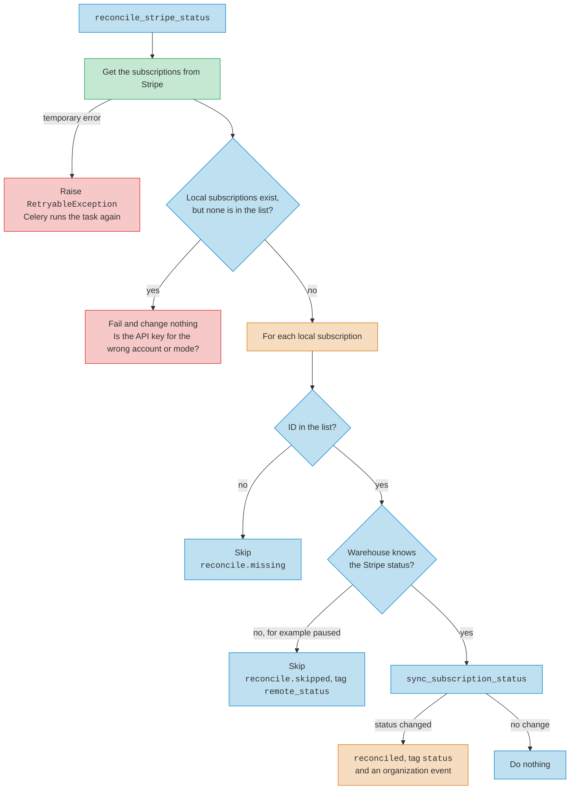

# Billing

To be in good standing, a company organization must be active. It must also
have a subscription with the status `active`, or a manual
activation that is not expired.

Stripe owns the subscription status. Warehouse keeps a copy in
`StripeSubscription.status`, so it does not call Stripe on every request.

## How the status changes

These paths call `sync_subscription_status` in
`warehouse/subscriptions/services.py`:

- The `customer.subscription.updated` and `customer.subscription.deleted`
  webhooks, in `warehouse/api/billing.py`.
- The `reconcile_stripe_status` task. It runs each night at 23:00 UTC and
  fixes a status that a lost webhook did not update.

Other writes do not use it. A new subscription starts as `active`. The
`checkout.session.completed` webhook sets an existing subscription to
`active` with `update_subscription_status`, and records no status event.

`sync_subscription_status` records an organization event for each change it
makes. It only writes if the stored status still has the value it read. If
not, it writes nothing and records no event. So if a webhook and the task make
the same change at the same time, only one of them records it.

## Reconciliation

The task lists the subscriptions of all statuses in the configured Stripe
account, up to 100 for each request. The list does not include subscriptions
on test clocks.

The task ignores local subscriptions that are `canceled`, because Stripe
cannot reactivate a canceled subscription. It compares each other local
subscription with the Stripe copy. Metric names start with
`warehouse.organizations.subscription.status.`

The diagram uses these colors:

- Warehouse code and checks
- Database reads, writes, and organization events
- Stripe API calls
- Failure the task raises

The task does not cancel a missing subscription. The Stripe list includes
canceled subscriptions and the subscriptions of deleted customers, so a
missing ID does not mean that the subscription is canceled. If
`reconcile.missing` or `reconcile.skipped` keeps going up, examine those
subscriptions by hand.

## Usage reports

`update_organziation_subscription_usage_record` runs at 00:00 UTC, one hour
after reconciliation. Only the clock puts the two tasks in order. If
reconciliation is late or fails, the usage task uses the old status.

The task skips canceled subscriptions. A temporary Stripe error makes the task
raise `RetryableException`. Other Stripe errors go to the log and to the
`warehouse.organizations.subscription.usage_record.error` metric, and the task
continues with the next subscription.

## Local development

`dev/environment` sets `BILLING_BACKEND` to `MockStripeBillingService`,
which sends requests to the `stripe` mock container. The mock does not save
changes and returns fixed data, so you cannot use it to see how
reconciliation works with Stripe.
