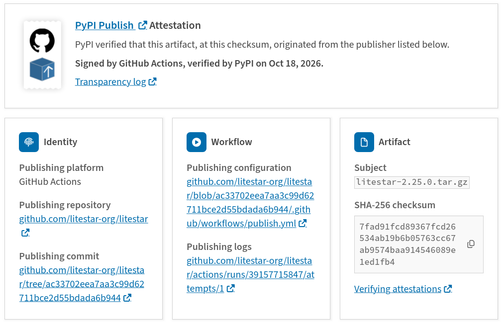
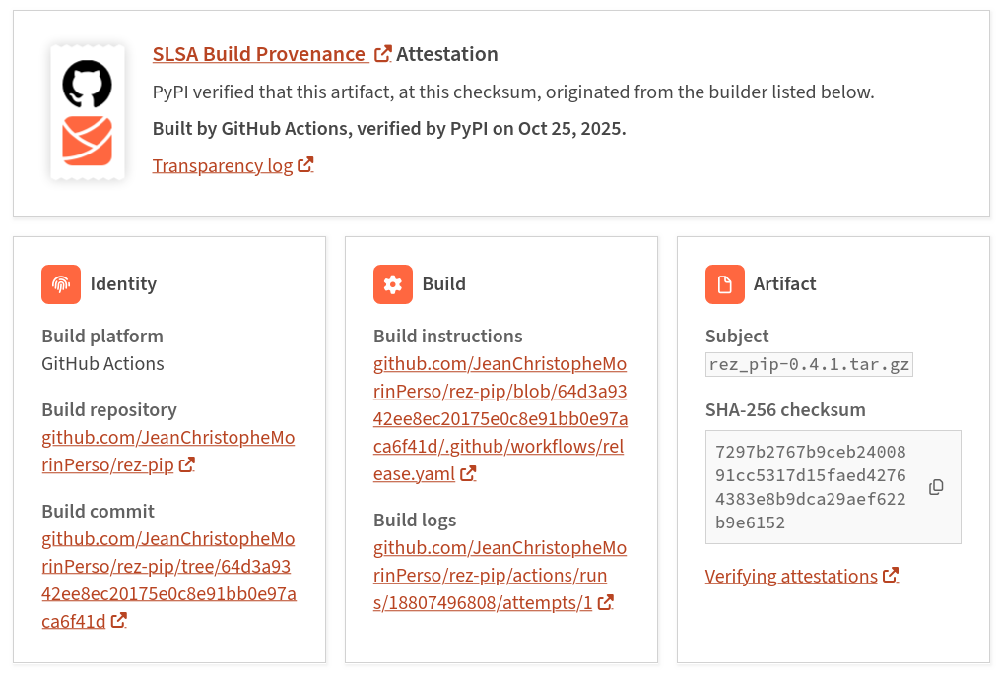

# Checking Provenance - where a package came from

## What is Provenance?

**Provenance** describes where a release file came from. On PyPI, provenance is shared via **attestations**, which provide a verifiable record of the build or publishing details.

## What is an attestation?

An [attestation](../../attestations/index.md) describes how, when, and where a package was built or published.

The presence of an attestation, and the information within it, can help protect you from [account takeover attacks](common-attacks.md#account-takeover-ato) and [supply chain attacks](common-attacks.md#supply-chain-attacks).

Attestations can be [verified](../../attestations/consuming-attestations.md), confirming that a file really came from the source it claims to come from.

## Attestations on PyPI

If a file on PyPI has an attestation, it is displayed:

1. On the "Security" tab
2. On the file detail page

Attestations contain key details about the origin of the file, which may include:

* What source repository and source commit was used to build or publish the package
* What platform (e.g. GitHub Actions) built or published the package
* What workflow built or published the package

Each attestation is recorded in a public ledger as a [transparency log entry](https://docs.sigstore.dev/logging/overview/) ([example](https://search.sigstore.dev/?logIndex=227282797)), which is a permanent, auditable record that cannot be changed.

## Attestation types

PyPI currently supports two types of attestations:

### 1. [PyPI publish attestations](../../attestations/publish/v1.md)

An attestation, created and signed by the uploading workflow, confirming that a file was uploaded via a supported [PyPI Trusted Publisher](../../trusted-publishers/index.md), and that a specific Trusted Publisher identity was used to publish the file, such as a particular GitHub Actions workflow.

PyPI verifies this attestation at upload time, confirming that the identity matches what the package maintainer previously configured for Trusted Publishing.

Currently, the majority of attestations on PyPI are PyPI publish attestations. This is because producing these attestations happens by default (unless disabled) in [the canonical workflow used by many package maintainers to publish packages](https://github.com/marketplace/actions/pypi-publish).

<figure markdown="1">
  { loading=lazy }
  <figcaption markdown="span">A [PyPI Publish attestation](../../attestations/publish/v1.md) on PyPI</figcaption>
</figure>

### 2. [SLSA attestations](https://slsa.dev/provenance/v1)

An attestation and associated transparency log, signed by the build platform (e.g., GitHub, Google Cloud), that details exactly how the file was produced, cryptographically linking the final artifact back to its original source code (if available), build instructions or build log.

<figure markdown="1">
  { loading=lazy }
  <figcaption markdown="span">A [SLSA Build Provenance attestation](https://slsa.dev/spec/v1.2/build-provenance) on PyPI</figcaption>
</figure>

## Verifying attestations

Verifying an attestation confirms that the release file really came from the source it claims to come from.

Verification isn't yet built into common package installers, but third-party tools exist today — for example, [pip-plugin-pep740](https://github.com/trailofbits/pip-plugin-pep740) verifies attestations before allowing an install to proceed. Native support has been proposed for both [pip](https://github.com/pypa/pip/issues/12766) and [uv](https://github.com/astral-sh/uv/issues/9122), but neither is actively in development yet.

In the meantime, users can manually verify attestations by retrieving them from PyPI's [Integrity API](../../api/integrity.md). See our [documentation on consuming attestations](../../attestations/consuming-attestations.md) for additional information.

## No provenance

"No provenance" simply means that no file in the release has an attestation. This is typical for older releases or projects that have not yet configured Trusted Publishing. **No provenance does not necessarily indicate that a release or release file is malicious; it instead means that the _file origin cannot be cryptographically verified_**.

When there is no provenance, you should rely on [surrounding trust signals](source-code-security.md) to assess security, such as maintainer history, release patterns, and repository activity. If you maintain the package, consider using [Trusted Publishing](../../trusted-publishers/index.md) with a [publisher that generates attestations](../../attestations/producing-attestations.md) for your next release.

## Provenance/attestation warnings

When a release's provenance looks unusual or conflicts with the project's history, PyPI displays a warning. These warnings help you identify files that may not have come from the project's maintainers, for example if an attacker has taken over an account or a publishing workflow (see [supply chain attacks](common-attacks.md#supply-chain-attacks)).

Many warnings have legitimate explanations, but each one is worth checking before you install.

### Incomplete provenance
*   **What it means:** A portion of the files in this release were uploaded without an attestation.
*   **Why it matters:** This can be a deliberate choice by the maintainers (such as mixing manual uploads with automated CI workflows), a build or publishing configuration error, or a sign that some of the files were uploaded by a malicious actor.
*   **What to do:** Check the release notes for build issues, or ask in the project's issue tracker before installing.

### Inconsistent provenance
*   **What it means:** The attestation metadata indicates that the release files were produced by different, unrelated build or publishing pipelines, or originated from different source repositories.
*   **Why it matters:** A release's files usually share the same provenance. If files within the same release exhibit different provenances, it can suggest that some or all of the files come from a malicious source.
*   **What to do:** Check the attestation metadata to confirm that all files came from sources controlled by the maintainers.

### Change of provenance
*   **What it means:** The build or publishing pipeline or source identity that made the release files differ from a previous release.
*   **Why it matters:** While this is often the result of a legitimate infrastructure migration (e.g., moving a project to a new GitHub organization or switching to a different CI platform), it can also be a signal of a supply chain attack or account takeover.
*   **What to do:** Inspect the attestation metadata to see what changed, such as a new source repository or workflow. Check the project's release notes or official communication channels to confirm that the change was an intentional transition by the maintainers.

### Loss of provenance
*   **What it means:** Either:
    * The maintainers previously used secure, verifiable build or publishing methods (such as [Trusted Publishing](../../trusted-publishers/index.md)), but have changed to a manual or unverified process, or
    * The maintainers have changed their publishing configuration to no longer produce an attestation.
*   **Why it matters:** While this may simply reflect a conscious choice by the maintainers to change their publishing workflow, it can also signal an account takeover where an attacker has bypassed secure publishing requirements.
*   **What to do:** Check the project's security policy, release notes or recent announcements to confirm that the maintainers intentionally changed their publishing process.

!!! note

    "Change of provenance" and "Loss of provenance" warnings are only raised when the provenance of the release files differs from a release made in the preceding **14 days**.

## Attestation limitations

Attestations are a big step forward for securing the Python packaging ecosystem, but they do have limitations:

* **Code Safety**: An attestation only tells you where a file came from. It does not mean the original code or the build environment is safe or trustworthy.

* **Implicit Trust**: When you trust an attestation, you are implicitly trusting the processes and authority of the organization that issued it. 

See the [attestations security model documentation](../../attestations/security-model.md) for a more detailed look into what attestations actually assert, and the trust assumptions behind them.
